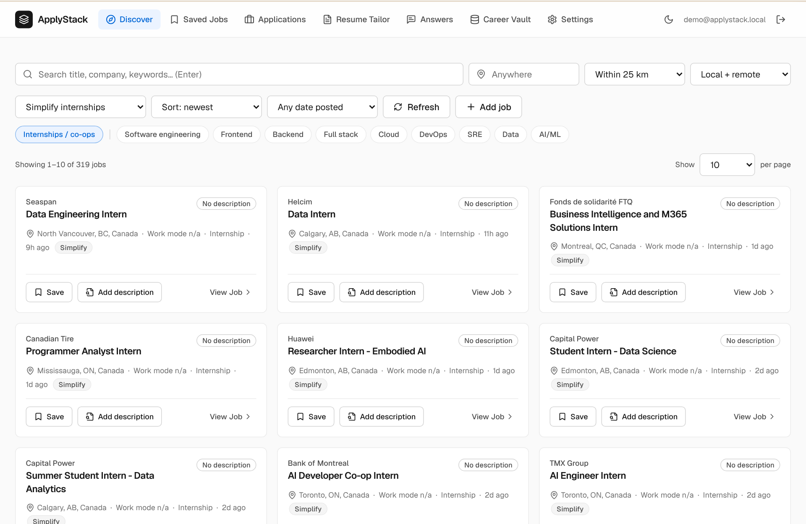
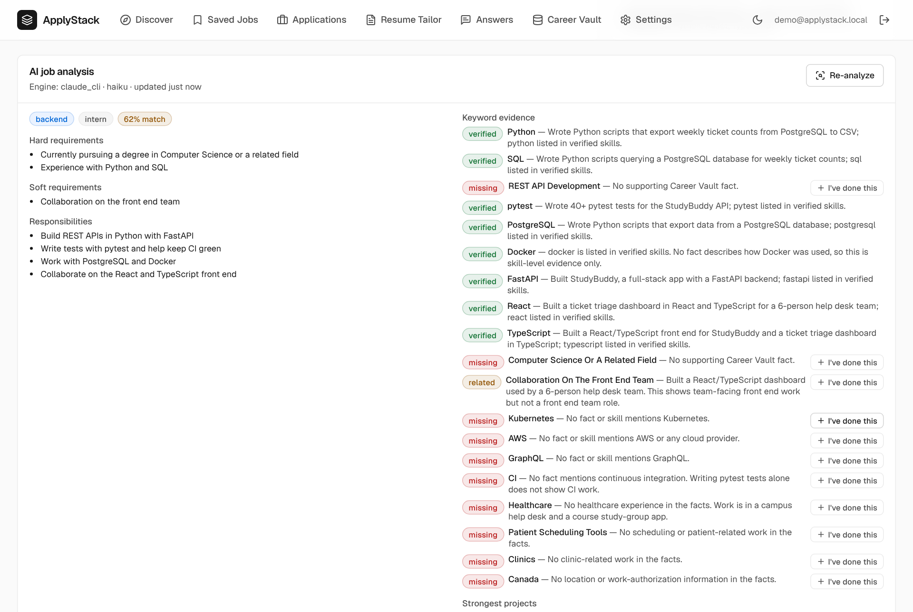
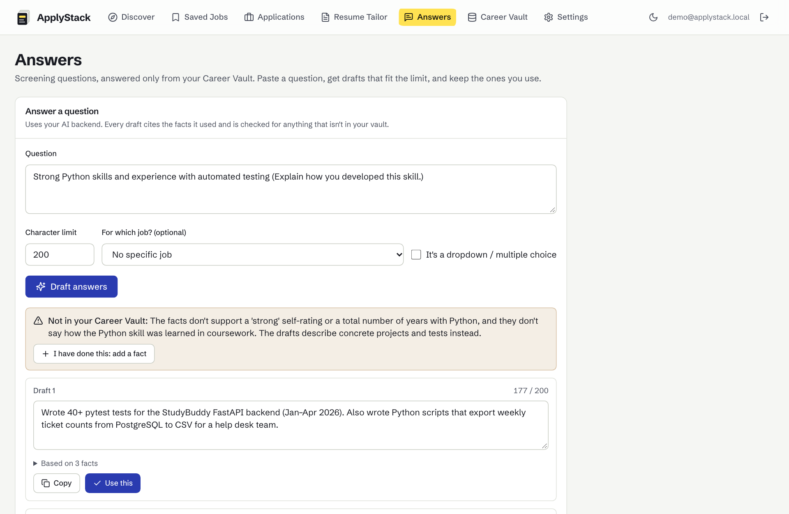
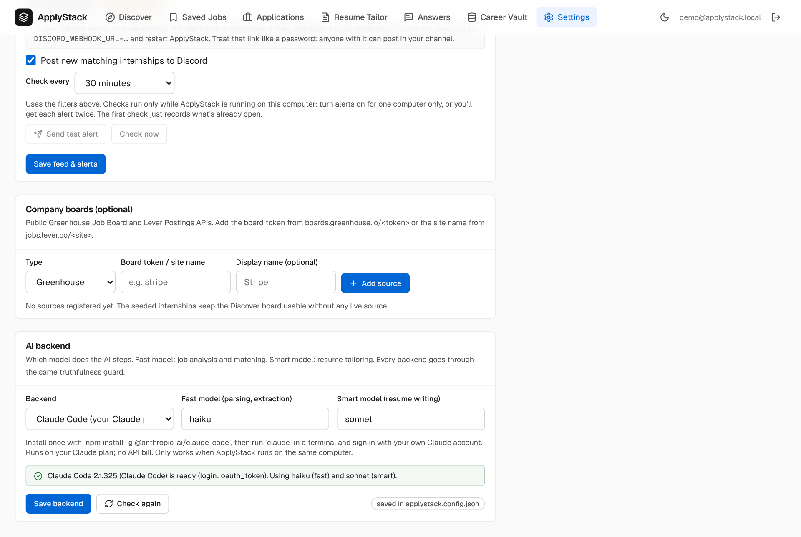

# ApplyStack

**An internship search app that tailors your resume without ever making things up.**

ApplyStack pulls internship postings from public feeds, scores each one against a structured
profile of what you've actually done, and rewrites your resume bullets for a specific job. Every
AI output is checked by deterministic code: a rewrite that adds a technology, number or claim
you can't back with an approved fact is rejected before you see it.

I built it for my own co-op and internship search. It runs locally on your machine, syncs across
devices through Supabase, and can use your existing Claude or ChatGPT plan instead of a paid API.



## What it does

- **Discover:** one paged board over several sources: the Simplify internship list, public
  Greenhouse, Lever and Ashby job boards, and the Adzuna search API. Filters for location, distance,
  remote, role type and date. Sources are plugins, so adding another job API is one file.
  Settings has ready-made board lists (big intern programs, Canadian tech, AI labs, dev tools),
  so you can scan 70+ companies without looking up board tokens.
- **Import from anywhere:** a bookmarklet and a paste box turn a LinkedIn, Indeed or company
  posting you're looking at into a job in ApplyStack. Nothing is scraped; you send the page
  you already have open.
  You can also paste a LinkedIn or Indeed job-alert email: every job it lists is saved to your
  pipeline after you review the list.
- **AI job analysis:** requirements, ATS keywords and a match score, with each keyword marked
  verified, related or missing based on your Career Vault. If you've done something it marks
  missing, "I've done this" adds it to your fact bank for review.
- **Verdict + posting checks:** an Apply / Consider / Skip verdict read from the guarded score.
  A match that rests on "related" rather than proven keywords, or misses a stated requirement,
  can't reach Apply, and the evidence confidence is shown separately. Posting checks flag postings
  that are stale, no longer listed, have no visa sponsorship, need citizenship or clearance, may be
  unpaid, or ask applicants for a fee. Both ideas are adapted from
  [career-ops](https://github.com/career-ops-hq/career-ops) (MIT).
- **Resume tailoring:** upload your Word resume (or LaTeX); ApplyStack rewrites and reorders
  bullets for the job and returns the same file with your formatting untouched. Every change
  shows its reason and the facts it relies on before you accept it.
- **Answers:** drafts for screening questions ("Explain how you developed this skill", skill
  ratings, years of experience) that fit the character limit and cite your facts. Questions it
  can't answer truthfully, like work authorization, are left to you.
- **Cover letters in your voice:** add your past letters to the Career Vault and new letters copy
  their voice and structure (never their claims). Every paragraph cites your facts and passes the
  same skill and number checks; contact details are stripped before anything reaches the AI. The
  .docx is built inside one of your own letters, so the header, fonts and spacing match what you
  already send. Pick a focus (why it fits, problems you'd solve, how you work) and a tone.
- **Pipeline:** analyze every saved job in one go. The free match score skips obvious mismatches
  first, descriptions are fetched from the job board where possible, and the results are ranked
  by verdict.
- **Applications + alerts:** a kanban/table pipeline with CSV import, and optional Discord alerts
  when new internships matching your filters appear.
- **Follow-ups:** Applications shows which applications are due a nudge (a week after applying,
  again a week later, and after an assessment or interview), each with a short draft to copy.
  Nothing is sent for you; mark it sent and the next one is scheduled.
- **Outreach:** an application email (with subject and attachment checklist), a referral request,
  a note to the hiring manager, or a 300-character LinkedIn note for a recruiter or an engineer,
  in your voice and from your facts, with the same checks. Nothing is sent for you.
- **Interview prep:** STAR stories built only from your approved facts and mapped to the posting's
  requirements, topics to review and questions to ask. The reflection is a question for you to
  answer, never written for you. Every story also lands in the Career Vault's story bank.
- **Insights:** your funnel, reply and advance rates by channel and by kind of role (small samples
  flagged), requirements you keep missing across jobs you applied to, and applications gone quiet.
  Job pages also flag a posting the company has listed before (repost detection).

| AI job analysis with keyword evidence | Screening-question drafts |
| --- | --- |
|  |  |

## Engineering highlights

- **Truthfulness guard** (`src/lib/ai/guard.ts`): model output is validated with Zod, then
  checked against the vault: unknown skills or numbers are rejected, and a keyword missing from
  the vault can never be reported as verified. 150+ unit tests cover the guard, sources, import,
  answers and AI backends.
- **Swappable AI backend** (`src/lib/ai/llm.ts`): one `askLlm(prompt, tier)` function over six
  backends. Two of them run local CLIs headlessly (`claude -p` and `codex exec`) with tools
  disabled, a read-only sandbox, and API-key variables stripped from the child process, so they
  bill your subscription instead of an API key.
- **Pluggable job sources** (`src/lib/jobs/sources/`): each source implements one interface;
  results are cached server-side and only the current page is written to the database.
- **Supabase with row-level security** on every table, plus a demo mode that swaps in an
  in-memory database so the whole app runs with no account.



## Core concepts

- **Career Vault** — one structured source of truth: education, experiences, projects, skills,
  and an atomic **fact bank**. The AI can only ever use what lives here.
- **Master resume** — upload your Word (`.docx`) resume or paste LaTeX. Template, content, and
  facts are kept separate; tailoring edits bullet text and skills lines only and gives you back
  the same file format with every font, tab stop, heading and date untouched.
- **One-click tailoring** — analyze a job, rank your verified facts, rewrite/reorder/remove
  bullets, and review every change side-by-side with provenance (reason, cited facts,
  targeted keywords) before accepting.
- **Applications** — kanban + table pipeline from Saved through Offer, with CSV import from a
  spreadsheet tracker (App Date, Org, Job Title, Posting, Site, Interview, Decision…).

### The truthfulness contract

ApplyStack never invents experience, technologies, metrics, dates, employers, degrees, or
certifications. This is enforced in three layers:

1. **Context control** — the model only receives approved Career Vault facts selected by a
   deterministic relevance filter.
2. **Schema validation** — every AI response is parsed with Zod (one retry on malformed output).
3. **The guard** (`src/lib/ai/guard.ts`) — deterministic post-validation: rewrites that introduce
   technologies or numbers unsupported by the original bullet or a cited approved fact are
   rejected outright; match reports can never mark a vault-missing keyword as "verified";
   changes without fact support are flagged unsafe and excluded from "Accept All Safe Changes".

Missing qualifications are always shown as missing — never papered over.

## Tech stack

Next.js 15 (App Router) · TypeScript · Tailwind CSS · Supabase (Postgres + Auth + RLS) ·
a switchable AI backend (Claude Code or Codex CLI run headless, or the Anthropic, OpenAI or
Gemini API via the Vercel AI SDK) · Zod · node:test.

## Try it without any setup (demo mode)

```bash
npm install
echo APPLYSTACK_DEMO=1 > .env.local
npm run dev        # http://localhost:3000
```

The AI steps use Claude Code by default (see [AI backend](#ai-backend)). To click around with no AI
at all, pick **Offline** in Settings → AI backend.

Demo mode swaps Supabase for a local in-memory database (saved to `.demo-data.json`) with one
user and no login, so you can click through every feature: load your profile, upload your Word
resume, tailor, review, download, and import applications. Delete `.demo-data.json` to start
fresh. Never enable demo mode on a deployed site; it has no authentication.

## Setup

### 1. Install

```bash
npm install
```

Requires Node 22+ (the AI SDK needs it).

### 2. Create a Supabase project

1. Create a project at [supabase.com](https://supabase.com) (free tier is fine).
2. In the SQL editor, paste and run `supabase/setup_all.sql` once. It is migrations 0001–0008
   in order (schema, row-level security, Word resumes, AI backends, table grants, internship
   feed, pluggable sources, application answers), so it works whether or not "Automatically expose new tables" is on.
   Already set up with an older `setup_all.sql`? Run only the migrations you haven't run yet
   (e.g. `0006_simplify_feed.sql`, `0007_pluggable_sources.sql`, then `0008_application_answers.sql`).
   `supabase/seed.sql` adds 14 sample internships from fictional companies; skip it for real use.
3. (Optional, for local dev convenience) Authentication → Providers → Email → disable
   "Confirm email" so signup works without an SMTP setup.

Or with the Supabase CLI: `supabase db push` then `psql < supabase/seed.sql`.

### 3. Environment

```bash
cp .env.example .env
```

| Variable | Required | Purpose |
| --- | --- | --- |
| `NEXT_PUBLIC_SUPABASE_URL` | yes | Supabase project URL |
| `NEXT_PUBLIC_SUPABASE_ANON_KEY` | yes | Supabase anon key |
| `ANTHROPIC_API_KEY` | only for the Anthropic API backend | Your Anthropic Console key |
| `OPENAI_API_KEY` | only for the OpenAI backend | Your OpenAI key |
| `GEMINI_API_KEY` | only for the Gemini backend | Your Google AI Studio key |
| `APPLYSTACK_LLM_PROVIDER` | no | Forces a backend (`claude_cli`, `anthropic`, `openai`, `gemini`, `offline`), overriding the Settings page |
| `CLAUDE_CLI_PATH` | no | Full path to `claude` if it isn't on `PATH` |
| `APPLYSTACK_CONFIG` | no | Where the backend settings file lives (default `./applystack.config.json`) |
| `GREENHOUSE_BOARDS` | no | Comma-separated Greenhouse board tokens to ingest |
| `LEVER_SITES` | no | Comma-separated Lever site names to ingest |
| `ASHBY_BOARDS` | no | Comma-separated Ashby job board names to ingest |

Job sources can also be managed per-user in **Settings → Job sources**.

### 4. Run

```bash
npm run dev        # http://localhost:3000
```

Sign up, then:

1. **Career Vault → Overview → Load my profile.** Loads your profile from
   `applystack.profile.json` in the project folder (git-ignored, so your resume details never
   leave your computer), or a fictional sample profile (`src/lib/vault/starter.ts`) if that file
   doesn't exist. The JSON has the same shape as the sample: `education`, `experiences`,
   `projects` (each with `facts`), `skills` and `facts`. Facts marked *pending* wait for you to
   approve or reject them in Fact Bank. Everything is editable in the app afterwards.
2. **Career Vault → Master Resume → Word (.docx) → Set as master.** Pick the resume you'd send by
   default. Tailoring can rewrite, reorder and trim its bullets and skills lines, but cannot add
   projects that aren't in it, so choose one with your strongest projects.
3. **Applications → Import CSV** to bring in an existing spreadsheet tracker.

## Discover: sources, paging and filters

Discover reads jobs live from pluggable sources (`src/lib/jobs/sources`) and shows one page at a
time: **Show 10 / 25 / 50 per page**, Prev / page numbers / Next, and "Showing 1–25 of N jobs".

| Source | What it is | Paging |
| --- | --- | --- |
| Simplify internships | Simplify's public internship list (one JSON file on GitHub), filtered in Settings → Internship feed & alerts | downloaded at most every 30 min, paged locally |
| Adzuna | Adzuna's job search API, `country=ca` by default; needs `ADZUNA_APP_ID` / `ADZUNA_APP_KEY` (from developer.adzuna.com; the free tier is a few test calls, then a paid plan) | one API request per page you open |
| Company boards | Greenhouse / Lever boards from Settings → Company boards | each board cached 30 min, paged locally |
| Added by you | Jobs from **Add job** (any site, including Indeed and LinkedIn) | from your database |

- **Filters:** search (Enter), **Location** (default "Vancouver, BC"; empty = anywhere), radius
  (Adzuna uses it; the other sources match the city and its metro area, e.g. Burnaby and Richmond
  for Vancouver), **Local + remote / Local only / Remote only**, source, sort, date posted,
  internships/co-ops and categories. Every card shows a badge for the source it came from.
- **Sort:** newest, or most relevant to your search words (Adzuna ranks with its own relevance;
  the other sources rank title matches above company and description matches).
- **Only the current page does any work.** "All sources" asks each source for just enough jobs to
  fill the page you're on, merges them by date, and moves on one page at a time. Results are
  cached on the server (Adzuna pages 15 min, lists 30 min) and in the browser for 3 minutes, so
  going back doesn't refetch; **Refresh** clears the cache. Only the jobs on the page you're
  viewing are saved to your database, descriptions are fetched only for them, and no AI call ever
  runs from Discover (match scores are deterministic; analysis and tailoring are buttons).
- **Adzuna limits:** keys have a request limit, which the per-page fetching and caching
  are designed around. Adzuna only returns a short preview of each description; the card and job
  page show it, and you add the full description with Get description or Paste.
- **Indeed and LinkedIn** aren't sources: neither offers a public API for this, and ApplyStack
  never scrapes. Use **Add job** with the link and the copied description.
- **Adding a source** (Job Bank Canada, JSearch, …): write one file exporting a `JobSourcePlugin`
  (`status()` and `fetchWindow(query, offset, limit)`), add it to `ALL_SOURCES` in
  `src/lib/jobs/sources/index.ts`, and add its badge name in `badges.ts`.

## Adding jobs from LinkedIn, Indeed or any site

LinkedIn and Indeed have no public API, and ApplyStack never scrapes them. Instead you hand it the
job you're already looking at:

- **Paste the whole page:** on the job page press Ctrl+A, Ctrl+C, then Discover → **Add job** →
  paste → **Find the job in this text**.
- **Send to ApplyStack bookmark:** on the Add job page, drag the button to your bookmarks bar. On
  a LinkedIn or Indeed job, click it: it reads the job header and description already on your
  screen (or your text selection) and opens Add job with it. The text travels in the URL's `#`
  part, which browsers never send to a server, and the bookmark never loads anything from LinkedIn
  or Indeed itself. LinkedIn's terms discourage tools that copy its content, so use it one job at
  a time for jobs you're reading.

Either way, your AI backend (fast model) only *locates* the company, title, location and the first
and last words of the description. ApplyStack checks each value against the page text (anything
not on the page is left blank) and cuts the description out of the original text word for word.
Offline, it falls back to the tab title and the page's "About the job" / "Full job description"
section. You review everything before **Add job**. Links are normalised to one per job
(`linkedin.com/jobs/view/<id>/`, `indeed.com/viewjob?jk=<id>`), so sending a job twice updates it,
and the card gets a LinkedIn / Indeed badge (under **Added by you** in Discover).

## Answers: application screening questions

**Answers** (in the nav, or **Answer a question** on any job page) drafts answers to screening
questions from your Career Vault only:

- Paste the question and the box's character limit, optionally pick the job. You get 2–3 drafts
  that fit the limit, each citing the facts it used ("Based on N facts"). For dropdown or
  multiple-choice questions, tick the box, list the options, and it suggests one with a reason
  (years of experience counted from your dated roles and projects; skill ratings kept honest).
- Every draft is checked: over the limit, a technology that isn't in your vault, or a number that
  isn't in your facts is shown in red. Questions your vault can't support (work authorization,
  salary, a skill with no evidence) say what's missing instead of guessing, with **I have done
  this: add a fact** to add it in your own words and draft again.
- **Use this** saves the answer to your **answer bank** (linked to the job, shown on its page);
  similar questions later show your earlier answers first. Short and multiple-choice questions use
  the fast model, longer ones the smart model.
- Needs `supabase/migrations/0008_application_answers.sql` to save answers.

## Job descriptions and Discord alerts

**Descriptions.** Simplify and Adzuna listings arrive without a full description, and tailoring needs one:

- Greenhouse, Lever and Ashby links: fetched automatically from each company's public job API
  for the jobs on the Discover page you're viewing, and on demand with **Get description**.
- Workday links: **Get description** reads that one posting from the careers site's own job data,
  only when you click it.
- Anything else: **Paste it** on the job page.
- **Discover → Add job** adds a posting from any site; paste the link and click **Fill from link**
  for the four sites above, or type the details and paste the description.

Jobs without a description show "No description" instead of a match score, and analysis and
tailoring wait until one is added.

**Discord alerts.** In your Discord server: channel settings → Integrations → Webhooks → New
Webhook → Copy Webhook URL. Put it in `.env.local` as `DISCORD_WEBHOOK_URL=…` and restart. While
ApplyStack runs, it checks the list on your interval (15 min – 4 h) and posts new listings that
match your filters, with the apply link and a link back to ApplyStack. The first check only
records what's already open (no flood), changing your filters starts a fresh baseline, and an
unchanged list is skipped via ETag. Seen listings are kept in `.applystack-alerts.json`
(git-ignored). Turn alerts on for one computer only, or every alert arrives twice. The webhook URL
works like a password: anyone with it can post in that channel.

## AI backend

Every AI call goes through one function, `askLlm(prompt, tier, system)` in `src/lib/ai/llm.ts`.
Pick the backend in **Settings → AI backend**:

| Backend | Pays with | Default fast / smart model |
| --- | --- | --- |
| **Claude Code (default)** | your Claude Pro/Max/Team plan's usage limits | `haiku` / `sonnet` |
| Codex CLI | your ChatGPT Plus/Pro/Business plan's Codex usage | `gpt-6-luna` / `gpt-6.1-sol` |
| Anthropic API | your Anthropic Console key | `claude-haiku-5-5` / `claude-sonnet-5-5` |
| OpenAI API | your OpenAI key | `gpt-6-luna` / `gpt-6.1-sol` |
| Gemini API | your Gemini key | `gemini-3.1-flash-lite` / `gemini-3.5-flash` |
| Offline | nothing | deterministic engine, no AI |

- **Fast** model: job analysis and match reports. **Smart** model: resume tailoring.
- Leave the model boxes blank to use the defaults above (one table, `PROVIDER_DEFAULTS` in
  `llm.ts`). Model IDs change; if a provider retires one, type the new ID in Settings.
- The choice is saved to `applystack.config.json` (git-ignored; see
  `applystack.config.example.json`). That file never holds API keys: keys come only from
  environment variables.
- On server start and every time you save the toggle, ApplyStack checks the backend (Claude
  Code installed and logged in, or the key set) and shows a red banner with the fix if not.
- Each call has a timeout (90 s fast, 240 s smart, or `timeout_seconds` in the config) and one
  retry. The server log shows a line per call with provider, model, tier, attempt and duration.
- Every backend goes through the same Zod validation and truthfulness guard.

### Claude Code (uses your Claude plan, no API key)

```bash
npm install -g @anthropic-ai/claude-code
claude          # run once and log in with your Claude account, then exit
```

ApplyStack runs `claude -p` with JSON output, tools disabled, no MCP servers and no saved
session, in an empty temp folder. It removes `ANTHROPIC_API_KEY` and `ANTHROPIC_AUTH_TOKEN` from
the subprocess environment, so Claude Code uses your plan login rather than billing an API key.
If `claude` itself is logged in with an API key (`claude auth status`), Settings warns you.

This only works when ApplyStack runs on the same computer where you logged in to `claude`.
Usage counts against your plan's normal limits, shared with Claude chat and Claude Code.

### Codex CLI (uses your ChatGPT plan, no API key)

```bash
npm install -g @openai/codex
codex login     # sign in with ChatGPT
```

ApplyStack runs `codex exec` with the prompt on stdin, a read-only sandbox, `--ephemeral` (no
saved session) and `--skip-git-repo-check`, in an empty temp folder, and reads the final answer
from `--output-last-message`. Codex has no separate system prompt, so ApplyStack's instructions
are put at the top of the prompt. It removes `OPENAI_API_KEY` and `CODEX_API_KEY` from the
subprocess environment so Codex uses your ChatGPT login. Settings checks `codex login status`
and warns if Codex is signed in with an API key. Set `CODEX_CLI_PATH` if `codex` isn't on PATH.

If you use Supabase, run `supabase/migrations/0009_more_ai_backends.sql` once so analyses made
with Codex can be saved.

### Anthropic, OpenAI or Gemini API

Put the key in `.env.local` (or `.env`), restart ApplyStack, then pick the backend in Settings:

```bash
ANTHROPIC_API_KEY=...   # console.anthropic.com
OPENAI_API_KEY=...      # platform.openai.com
GEMINI_API_KEY=...      # aistudio.google.com
```

`.env`, `.env.*` (except `.env.example`) and `applystack.config.json` are git-ignored.

### Use your own login or key

Each person who runs ApplyStack must use **their own** Claude or ChatGPT login or their own API
key. Don't share a subscription through ApplyStack, and don't deploy the Claude Code or Codex
backend on a server for other people to use; for a shared deployment, use an API backend with your own key.

## Commands

```bash
npm run dev          # dev server
npm run build        # production build
npm run start        # serve the production build
npm run lint         # eslint (next/core-web-vitals + next/typescript)
npm run typecheck    # tsc --noEmit over the whole app
npm test             # compiles tests with tsc, runs them with node --test (no test framework dep)
```

## How tailoring works (pipeline)

1. **Analyze** the job description → structured JSON (`JobAnalysisSchema`).
2. **Select** relevant approved facts deterministically (`matching/relevance.ts`) — the model
   never sees irrelevant vault content.
3. **Rank** projects/experiences against the job.
4. **Propose** bullet-level changes (the smart model, or the deterministic engine on Offline).
5. **Guard** every change (`ai/guard.ts`): unknown blocks, invented tech, invented numbers → rejected.
6. **Store** a `resume_version` + one `resume_change` row per proposal with full provenance:
   original text, tailored text, reason, supporting fact ids, targeted keywords, safety flag.
7. **Review** side-by-side; accept / reject / edit / restore each change. The final LaTeX is the
   master with only your accepted changes applied — structure byte-identical everywhere else
   (round-trip is unit-tested).

Versions support rename, duplicate, delete, restore (reset review), download in the master's
format (`.docx` rebuilt from your original file, or `.tex`), and a print/PDF content view. For a
Word master, open the downloaded `.docx` and use Save as PDF for the exact layout. Server-side LaTeX compilation is intentionally out of scope for the
MVP; the parsing/serialization layer (`resume/latex.ts`) is isolated so a compile step can be
added behind it later.

## Architecture notes

```
src/lib/
  jobs/        adapters (greenhouse, lever) → NormalizedJob; normalize, dedupe, registry, skills lexicon
  matching/    deterministic match scores + relevance ranking (the honest baseline)
  resume/      LaTeX block parser/serializer, change application, fact extraction, list reordering
  ai/          llm.ts (backend toggle + askLlm), prompts, zod schemas, structured calls, offline engine, truthfulness guard
  db/          supabase data access (vault snapshot/seeding, job listing/ingestion)
  supabase/    browser/server clients + auth middleware
```

- Job sources are isolated behind adapters that map external postings into one internal
  `NormalizedJob`; add a source by writing one adapter + registering tokens.
- Jobs are deduplicated on normalized company + title + location + canonical URL.
- Row-level security: every user-scoped table enforces `auth.uid() = user_id` for all
  operations; the shared `jobs` table is readable by any signed-in user and carries no user data.
- The core logic modules are dependency-free on purpose: the test suite runs with plain
  `tsc` + `node --test`, no test framework required.

## Tests

`npm test` covers: job normalization (incl. both adapters), deduplication, career fact
filtering/relevance ranking, match score calculation, AI schema validation, JSON extraction,
the truthfulness guard (invented tech/metrics rejection, match-report sanitization), LaTeX
round-tripping, resume change application (accept/reject/edit/remove), fact extraction, and
the full offline tailoring pipeline, and the AI backend layer (settings, Claude Code arguments
and environment, retry, timeout, readiness checks; tested against a fake `claude` script).

## Word resumes: how it works

A `.docx` is a ZIP of XML parts. ApplyStack stores the original file once (`template_base64`) and
parses only `word/document.xml` (`src/lib/resume/docx.ts`):

- Paragraphs formatted as Word bullets inside a section become editable bullets.
- "Label: a, b, c" lines in a Skills/Additional section become editable skills lines (the label
  stays exactly as is; only the values can be reordered).
- Everything else (name, contact line, section headings, job/project lines with right-aligned
  dates, page setup) is copied byte-for-byte.

A rewritten bullet keeps its paragraph properties (bullet, indent, tabs) and the run formatting of
its first text run. Downloads rebuild the archive with a dependency-free ZIP writer
(`src/lib/docx/zip.ts`) that passes fonts, styles and numbering through unchanged. The guard also
flags rewrites much longer than the original as unsafe, to protect one-page resumes.

## Known limitations

- Tailoring cannot add a project or job that isn't already in the master resume (it only
  rewrites, reorders or removes). Keep the master as your most complete one-pager.
- Mixed formatting inside a single bullet (e.g. one bold word) is flattened to the bullet's first
  run style when that bullet is rewritten. Untouched bullets keep everything.
- The `.docx` template is stored as base64 in Postgres (a few MB per master). Fine for one user;
  move it to Supabase Storage if this ever serves many users.
- PDF resume upload is not supported (upload the `.docx` or `.tex`).
- Print view renders resume *content*; exact layout comes from the downloaded file.
- Entry-level reordering of whole projects inside the LaTeX is conservative: tailoring
  rewrites/removes/reorders bullets and skill lists but does not physically move
  `\resumeSubheading` blocks (kept safe by design; the diff review explains selection instead).
